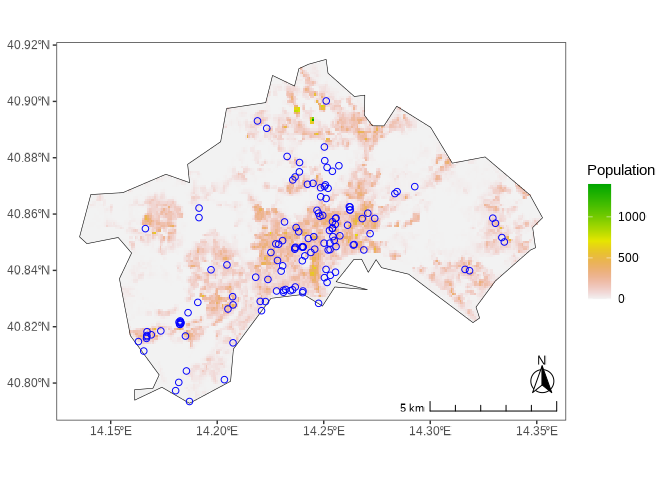
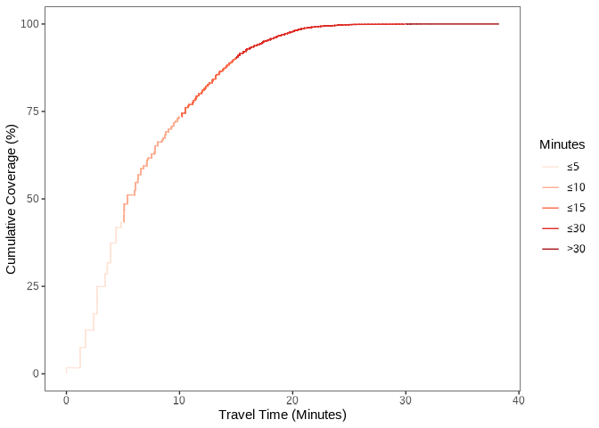
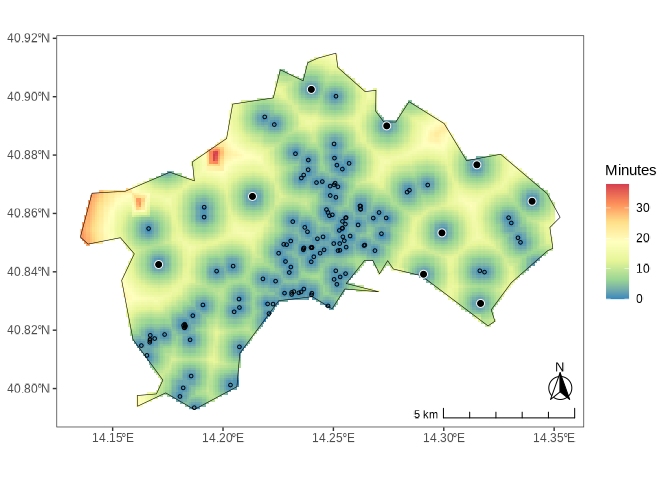
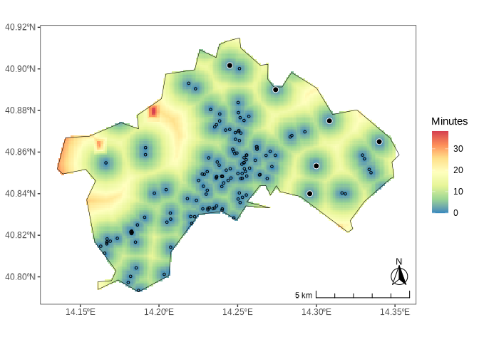
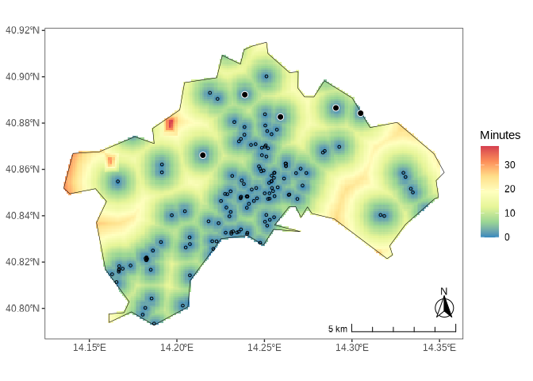
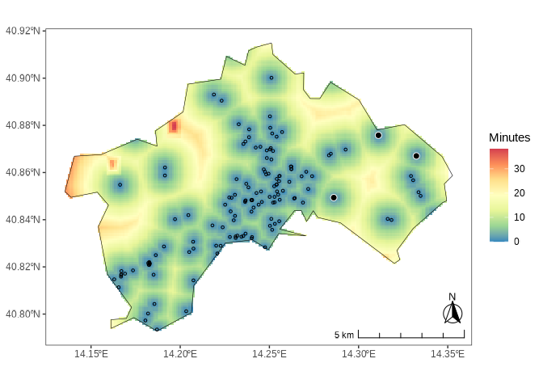
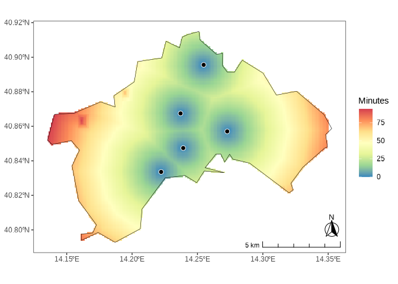

# locationallocation

## Overview

Assessing and planning infrastructure and service networks, given a
dispersed demand, limited capacity, accessibility targets, and concerns
about spatial justice, is a central policy challenge. Problems of this
type are commonly referred to as *Maximal Coverage Location-Allocation*
(MCLA) spatial optimization problems.

`locationallocation` is an R package that provides tools for solving
MCLA problems with geospatial data. It builds on widely used spatial
libraries in R, follows [tidyverse
principles](https://tidyverse.tidyverse.org/articles/manifesto.html),
and integrates seamlessly with the broader [tidyverse
ecosystem](https://tidyverse.org/). The package can generate travel-time
maps and optimize the placement of facilities or infrastructure
according to accessibility criteria, which can be weighted by one or
more variables or by a user-defined function.

Potential applications of the package extend to the domains of public
infrastructure assessment and planning (public services provision,
e.g. transport, social services, healthcare, parks), urban environmental
and climate risk reduction interventions, logistics and hubs allocation,
commercial and strategic decisions.

### How it works

- **Travel time.** Travel times are least-cost paths over the global
  friction surfaces of the [Malaria Atlas
  Project](https://malariaatlas.org/) (MAP), for walking or for the
  fastest mode of transport. At resolutions finer than their native ~1
  km, the surfaces are produced with the same rule used to build them
  (the fastest mode available in a cell takes precedence), using road
  speeds from [OpenStreetMap](https://www.openstreetmap.org/) for the
  fastest mode.
- **Allocation.** New facilities are added so as to maximize the share
  of (optionally weighted) demand that can reach a facility within a
  travel time threshold, until a target share is covered or a maximum
  number of facilities is reached. Facilities can be placed anywhere
  within the study area (continuous problem,
  [`allocation()`](https://giacfalk.github.io/locationallocation/reference/allocation.html))
  or chosen among candidate locations (discrete problem,
  [`allocation_discrete()`](https://giacfalk.github.io/locationallocation/reference/allocation.html)).
  Both problems are solved with a greedy heuristic, which adds at each
  step the location covering the most demand not yet covered ([Church &
  ReVelle, 1974](https://doi.org/10.1007/BF01942293)), refined by
  swapping locations as long as coverage improves ([Teitz & Bart,
  1968](https://doi.org/10.1287/opre.16.5.955)).
- **Online data.** Friction surfaces and road networks are downloaded on
  demand, with fallbacks (retries, mirrors, and a fallback surface) when
  online services are unavailable. Set `cache = TRUE` to store the
  downloaded data and reuse it in later calls.

> If you find this project useful, please consider giving it a star!  
> [](https://github.com/giacfalk/locationallocation/)

## Installation

You can install `locationallocation` using the
[`remotes`](https://github.com/r-lib/remotes) package:

``` r

# install.packages(remotes)
remotes::install_github("giacfalk/locationallocation")
```

The package has been submitted to [CRAN](https://cran.r-project.org/)
and is currently under review.

## Usage

To use the package, start by loading it to your R session using the
`library` function:

``` r

library(locationallocation)
```

As an example, we demonstrate how the package can address urban-scale
climate risk through infrastructure assessment and geospatial planning.
For this demonstration, we use the demo datasets included with the
package.

These datasets include the coordinates of public drinking water
fountains (blue dots) in Naples, Italy
([`naples_fountains`](https://giacfalk.github.io/locationallocation/reference/naples_fountains.html));
a gridded population raster from the Global Human Settlement Layer
([GHSL](https://human-settlement.emergency.copernicus.eu)) Population
Grid
([GHS-POP](https://human-settlement.emergency.copernicus.eu/download.php?ds=pop))
([`naples_population`](https://giacfalk.github.io/locationallocation/reference/naples_population.html));
a 100-meter resolution heat hazard map, representing the number of days
with [Wet-Bulb Globe
Temperature](https://en.wikipedia.org/wiki/Wet-bulb_globe_temperature)
above 25°C during 2008–2017, obtained from the
[UrbClim](https://www.urban-climate.eu/model) model
([`naples_hot_days`](https://giacfalk.github.io/locationallocation/reference/naples_hot_days.html));
and the city’s administrative boundaries
([`naples_shape`](https://giacfalk.github.io/locationallocation/reference/naples_shape.html)).



We can use the
[`traveltime()`](https://giacfalk.github.io/locationallocation/reference/traveltime.html)
function to create a map of current accessibility to the facility points
(represented by the [`sf`](https://r-spatial.github.io/sf/) object
[`naples_fountains`](https://giacfalk.github.io/locationallocation/reference/naples_fountains.html))
within the specified geographical boundaries. The function allows the
user to select a travel mode (walking or fastest route) and an output
spatial resolution in meters. At resolutions finer than the ~1 km
friction surfaces of the Malaria Atlas Project, the surface is produced
following the rules used by the Malaria Atlas Project, with road speeds
from [OpenStreetMap](https://www.openstreetmap.org/) for the fastest
mode (see the
[`friction()`](https://giacfalk.github.io/locationallocation/reference/friction.html)
documentation).

``` r

traveltime_data <-
  naples_fountains |>
  traveltime(
    bb_area = naples_shape,
    mode = "walk",
    res_output = 100
  )
```

For the fastest mode of transport (walking, cycling, and driving), set
`mode = "fastest"`. Speeds of the OpenStreetMap road classes can be
changed with the `road_speeds` argument (see
[`default_road_speeds()`](https://giacfalk.github.io/locationallocation/reference/default_road_speeds.html)),
and `cache = TRUE` stores the downloaded data for later calls:

``` r

traveltime_data_fastest <-
  naples_fountains |>
  traveltime(
    bb_area = naples_shape,
    mode = "fastest",
    res_output = 100,
    cache = TRUE
  )
```

Once
[`traveltime()`](https://giacfalk.github.io/locationallocation/reference/traveltime.html)
has completed, the resulting layer can be visualized using the
[`traveltime_plot()`](https://giacfalk.github.io/locationallocation/reference/traveltime_plot.html)
function.

``` r

traveltime_data |>
  traveltime_plot(
    bb_area = naples_shape,
    facilities = naples_fountains,
    contour_traveltime = 15
  )
```


We can also generate a summary plot and compute statistics using the
output of the
[`traveltime()`](https://giacfalk.github.io/locationallocation/reference/traveltime.html)
function, together with a demand raster (e.g., population counts) and a
specified time threshold, using the
[`traveltime_stats`](https://giacfalk.github.io/locationallocation/reference/traveltime_stats.html)
function:

``` r

traveltime_data |>
  traveltime_stats(
    demand = naples_population,
    breaks = c(5, 10, 15, 30),
    objectiveminutes = 15
  )
#> ℹ 90.14038% of coverage within the 15 minutes threshold.
```



We can now use the
[`allocation()`](https://giacfalk.github.io/locationallocation/reference/allocation.html)
function to optimize the placement of new water fountains, ensuring that
(virtually) everyone (i.e., the full extent of the raster layer
specified by the `demand` parameter) can reach one within 15 minutes, as
defined by the `objectiveminutes` parameter. At each step, the function
evaluates the actual catchment of a shortlist of promising locations and
adds the one that covers the most demand not yet covered; the solution
is then refined by moving facilities while coverage improves (see the
[function
documentation](https://giacfalk.github.io/locationallocation/reference/allocation.html)
for details):

``` r

allocation_data <-
  naples_population |>
  allocation(
    bb_area = naples_shape,
    facilities = naples_fountains,
    traveltime = traveltime_data,
    weights = NULL,
    objectiveminutes = 15,
    objectiveshare = 0.99,
    heur = "kd",
    approach = "norm",
    exp_demand = 1,
    exp_weights = 1
  )
```

``` R
#> ✔ Target coverage share of 99% attained with 9 new facilities within the 15
#> minutes threshold. The achieved coverage share is 99.11092%.
```

``` r

allocation_data |>
  allocation_plot(naples_shape, facilities = naples_fountains)
```



The new facilities are shown as filled dots and the existing ones as
hollow dots. To allocate a fixed number of new facilities instead, set
`objectiveshare = NULL` and use the `n_fac` parameter.

Note that it is also possible to solve an allocation problem using the
`weights` parameter, which assigns greater relative importance or
priority to areas where demand overlaps with weighting factors defined
by another raster layer, such as exposure to hot days, as shown in the
following example:

``` r

allocation_data <-
  naples_population |>
  allocation(
    bb_area = naples_shape,
    facilities = naples_fountains,
    traveltime = traveltime_data,
    weights = naples_hot_days, # <--- Changed
    objectiveminutes = 15,
    objectiveshare = 0.99,
    heur = "kd",
    approach = "norm",
    exp_demand = 1,
    exp_weights = 1
  )
```

``` R
#> ✔ Target coverage share of 99% attained with 9 new facilities within the 15
#> minutes threshold. The achieved coverage share is 99.16364%.
```

``` r

allocation_data |>
  allocation_plot(naples_shape, facilities = naples_fountains)
```


It is also possible to apply normalization and exponentiation to
different demand and weighting layers, enhancing their relative
influence on the allocation, using the `approach`, `exp_demand`, and
`exp_weights` parameters (see the [function
documentation](https://giacfalk.github.io/locationallocation/reference/allocation.html)
for details):

``` r

allocation_data <-
  naples_population |>
  allocation(
    bb_area = naples_shape,
    facilities = naples_fountains,
    traveltime = traveltime_data,
    weights = naples_hot_days,
    objectiveminutes = 15,
    objectiveshare = 0.99,
    heur = "kd",
    approach = "norm",
    exp_demand = 2, # <--- Changed
    exp_weights = 1
  )
```

``` R
#> ✔ Target coverage share of 99% attained with 6 new facilities within the 15
#> minutes threshold. The achieved coverage share is 99.06013%.
```

``` r

allocation_data |>
  allocation_plot(naples_shape, facilities = naples_fountains)
```



A variant of the allocation problem arises when the set of candidate
locations for new facilities is **discrete**, rather than **continuous**
across the study area as in the previous example.

In this case, the user must provide a set of candidate points via the
`candidate` parameter of the
[`allocation_discrete()`](https://giacfalk.github.io/locationallocation/reference/allocation.html)
function, along with the maximum number of facilities that can be
selected (`n_fac` parameter). The function computes the travel time from
each candidate location once, and then selects the candidates with a
greedy heuristic (adding, at each step, the candidate that covers the
most demand not yet covered), refined by swapping selected and
non-selected candidates as long as coverage improves. The solution is
deterministic and usually optimal or near-optimal. As with the
continuous allocation problem, a weight layer and normalization and
exponentiation parameters can also be specified.

``` r

library(sf)

allocation_data <-
  naples_population |>
  allocation_discrete(
    bb_area = naples_shape,
    candidate = naples_shape |> st_sample(20),
    facilities = naples_fountains,
    n_fac = 5,
    traveltime = traveltime_data,
    weights = NULL,
    objectiveminutes = 15,
    objectiveshare = NULL,
    approach = "norm",
    exp_demand = 1,
    exp_weights = 1,
    par = FALSE
  )
```

``` R
#> ℹ 5 facilities allocated within the 15 minutes threshold. The coverage share
#> attained is 94.67013%.
```

``` r

allocation_data |>
  allocation_plot(naples_shape, facilities = naples_fountains)
```



Now consider a scenario where the user wants to choose as few facilities
as possible, up to `n_fac`, to meet a target `objectiveshare` of the
total demand. If the target cannot be attained with the candidate
locations, the function reports the maximum coverage reached.

``` r

library(sf)

allocation_data <-
  naples_population |>
  allocation_discrete(
    bb_area = naples_shape,
    candidate = naples_shape |> st_sample(20),
    facilities = naples_fountains,
    n_fac = 10,
    traveltime = traveltime_data,
    weights = NULL,
    objectiveminutes = 15,
    objectiveshare = 0.92,
    approach = "norm",
    exp_demand = 1,
    exp_weights = 1,
    par = FALSE
  )
```

``` R
#> ✔ Target coverage share of 92% attained with 3 new facilities within the 15
#> minutes threshold. The achieved coverage share is 92.65155%.
```

``` r

allocation_data |>
  allocation_plot(naples_shape, facilities = naples_fountains)
```



Finally, consider a case with no preexisting facilities. The discrete
location-allocation problem must then identify where to place new
facilities to cover as much demand as possible, given the limited set of
spatial options and the cap on how many facilities can be allocated.
Since no travel time layer is supplied, the friction surface is computed
first.

``` r

library(sf)

allocation_data <-
  naples_population |>
  allocation_discrete(
    bb_area = naples_shape,
    candidate = naples_shape |> st_sample(20),
    facilities = NULL,
    n_fac = 5,
    traveltime = NULL,
    weights = NULL,
    objectiveminutes = 15,
    objectiveshare = NULL,
    approach = "norm",
    exp_demand = 1,
    exp_weights = 1,
    par = FALSE
  )
```

``` R
#> ℹ 5 facilities allocated within the 15 minutes threshold. The coverage share
#> attained is 37.41124%.
```

``` r

allocation_data |> allocation_plot(naples_shape)
```



## Citation

If you use this package in your research, please cite it to acknowledge
the effort put into its development and maintenance. Your citation helps
support its continued improvement.

``` r

citation("locationallocation")
#> To cite locationallocation in publications use:
#> 
#>   Falchetta, G. (2026). locationallocation: Solving Maximal Coverage
#>   Location-Allocation geospatial infrastructure assessment and
#>   planning problems [Preprint, version 2, manuscript submitted for
#>   publication]. EarthArXiv. https://doi.org/10.31223/X5XQ69
#> 
#> A BibTeX entry for LaTeX users is
#> 
#>   @Article{falchetta2026,
#>     title = {locationallocation: Solving Maximal Coverage Location-Allocation geospatial infrastructure assessment and planning problems},
#>     author = {Giacomo Falchetta},
#>     year = {2026},
#>     journal = {EarthArXiv},
#>     doi = {10.31223/X5XQ69},
#>     langid = {en},
#>     note = {Preprint, version 2, manuscript submitted for publication},
#>   }
```

## License

[](https://www.gnu.org/licenses/gpl-3.0)

``` text
Copyright (C) 2025 Giacomo Falchetta

locationallocation is free software: you can redistribute it and/or modify it
under the terms of the GNU General Public License as published by the Free Software Foundation, either version 3 of the License, or (at your option) any
later version.

This program is distributed in the hope that it will be useful, but WITHOUT ANY
WARRANTY; without even the implied warranty of MERCHANTABILITY or FITNESS FOR A
PARTICULAR PURPOSE. See the GNU General Public License for more details.

You should have received a copy of the GNU General Public License along with
this program. If not, see <https://www.gnu.org/licenses/>.
```

## Contributing

[](https://www.contributor-covenant.org/version/3/0/code_of_conduct/)

Contributions are welcome! Whether you want to report bugs, suggest
features, or improve the code or documentation, your input is highly
valued. Please check the [issues
tab](https://github.com/giacfalk/locationallocation/issues) for existing
issues or to open a new one.
